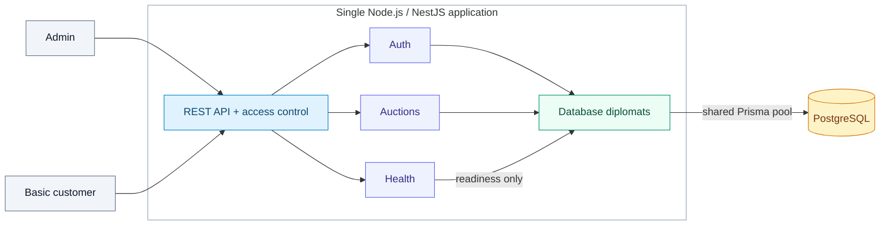
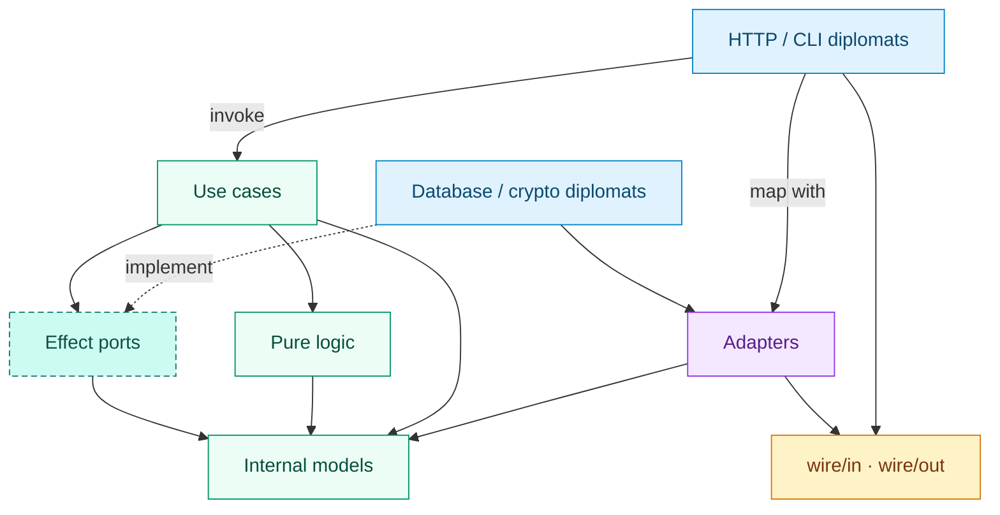

# Vehicle Auction Interview API

A Node.js/TypeScript backend built with NestJS, PostgreSQL, Prisma, and feature-oriented Diplomat boundaries.

**Interview API complete.** Health, authentication, Admin/Basic profiles, auction creation/activation, bidding, paginated listing, and deadline-based winner selection are implemented and verified. See [the contract](docs/auction-contract.md) for behavior and [current validation](docs/validation.md) for evidence.

## Project at a glance



The HTTP server uses one PostgreSQL database for users, auctions, and bids. Login and health are public; auction routes require a bearer token and the appropriate role. Liveness does not access the database. Local provisioning bootstraps the same modules in a separate CLI process.

## Local access

- API: `http://127.0.0.1:3100`; readiness: `/health/ready`.
- Admin: `admin@example.test`; password is `DEMO_ADMIN_PASSWORD` in the local `.env`.
- Customer: `buyer@example.test`; password is `DEMO_BUYER_PASSWORD` in `.env`.
- Postman: import [the collection](docs/postman/vehicle-auction.postman_collection.json) and [environment template](docs/postman/local.postman_environment.json). Set the two password variables from `.env` in your private Postman environment. Login requests save access tokens for subsequent requests. Do not commit real credentials or tokens.

For an existing checkout, preserve `.env`, apply migrations with `npm run db:migrate`, provision with `npm run auth:seed`, then start with `npm start` (or `npm run start:dev` for reloads). The following bootstrap commands are for a fresh checkout.

## Requirements and setup

- Node.js **26.7.0** (`.nvmrc`) and npm 11.
- Docker with the Compose plugin.
- Local ports **3100** (API), **55432** (development PostgreSQL), and **55433** (test PostgreSQL).

```sh
nvm install
nvm use
npm ci
cp .env.example .env
cp .env.test.example .env.test
# Replace the blank signing secret without printing it.
node -e 'const fs = require("node:fs"); const key = require("node:crypto").randomBytes(32).toString("hex"); fs.writeFileSync(".env", fs.readFileSync(".env", "utf8").replace(/^AUTH_TOKEN_SECRET=.*$/m, "AUTH_TOKEN_SECRET=" + key));'
npm run db:up
npm run db:migrate
npm run auth:seed
npm run start:dev
```

Copy environment examples only on a fresh checkout; preserve existing local configuration. Dependencies are pinned, and Prisma CLI, client, and adapter versions match. The app uses native ESM and strict TypeScript. Prisma generation runs during installation and production builds.

The API and databases bind to loopback by default. This remains local development software. `AUTH_TOKEN_SECRET` is required at startup and must contain at least 32 bytes. Use a randomly generated secret; there is no runtime fallback. `.env.test.example` supplies an explicitly disposable test-only secret. Existing local configuration was extended only with missing auth settings; existing values were preserved.

## Run the API with Postman

The repository includes a Postman Collection v2.1 file with **13 requests covering all seven implemented endpoints**, plus a credential-free local environment template. The collection exercises the main lifecycle and a lower-bid rejection; it does not replace the automated backend test suites.

### 1. Start the local application

Complete [Requirements and setup](#requirements-and-setup) first. Keep the API running at `http://127.0.0.1:3100` with PostgreSQL available, current migrations applied, and demo accounts provisioned. Importing Postman files does not start services, apply migrations, or create users.

For an already configured checkout, preserve existing environment files:

```sh
nvm use
npm run db:up
npm run db:migrate
npm run auth:seed
npm run start:dev
```

### 2. Import the collection and environment

In the Postman desktop application, open your workspace and select **Import** (or **Use resources or import → Import**, depending on the version). Select these two files:

- [Collection: vehicle-auction.postman_collection.json](docs/postman/vehicle-auction.postman_collection.json)
- [Environment: local.postman_environment.json](docs/postman/local.postman_environment.json)

Confirm that **Vehicle Auction Interview API** appears in Collections, with folders 01 through 05. Select **Vehicle Auction — Local** from the environment selector. Importing an environment does not necessarily select it automatically.

### 3. Configure local credentials and inputs

Open the selected environment and set the following values. Read password values from your own `.env`; enter the actual values, not the literal names `DEMO_ADMIN_PASSWORD` or `DEMO_BUYER_PASSWORD`.

| Postman variable   | Value                                                                              |
| ------------------ | ---------------------------------------------------------------------------------- |
| `base_url`         | `http://127.0.0.1:3100`, with no trailing slash                                    |
| `admin_email`      | `admin@example.test`                                                               |
| `admin_password`   | The password used to provision the Admin account (`DEMO_ADMIN_PASSWORD` in `.env`) |
| `buyer_email`      | `buyer@example.test`                                                               |
| `buyer_password`   | The password used to provision the Basic account (`DEMO_BUYER_PASSWORD` in `.env`) |
| `auction_end_time` | Leave blank for an automatically generated deadline 24 hours ahead                 |
| `limit` / `offset` | `20` / `0`                                                                         |
| `bid_amount`       | `1100000` EUR cents (EUR 11,000.00)                                                |

Keep passwords private in Postman. The committed template deliberately leaves both passwords and tokens blank. Re-running `auth:seed` preserves existing passwords; changing `.env` alone does not reset a previously provisioned account.

Do not manually fill `admin_access_token`, `buyer_access_token`, `buyer_id`, `auction_id`, `activated_at`, `first_bid_id`, `first_bid_amount`, or `last_bid_id`. The request scripts populate these in the selected environment. Authentication is already configured on each request; credentials belong in the login JSON body, not URL query parameters.

### 4. Execute requests in order

For a full run, open the collection's **Run** action, select all 13 requests, choose the configured environment, use **Functional → Local**, set **Iterations** to `1`, and keep variable values enabled. Start the run. If Runner is unavailable or its Start button remains disabled, open each request and click **Send** in the same order, checking **Test Results** before continuing.

| Folder                          | Requests and expected results                                                                                                             |
| ------------------------------- | ----------------------------------------------------------------------------------------------------------------------------------------- |
| `01 — Health`                   | Liveness and readiness: `200`.                                                                                                            |
| `02 — Authentication`           | Admin and Basic logins: `200`; tokens are saved automatically.                                                                            |
| `03 — Create and list auctions` | Create draft: `201`; save `auction_id`. Both listing requests: `200`.                                                                     |
| `04 — Activation`               | Activate: `200`. Repeat activation: `200`, preserving the first timestamp.                                                                |
| `05 — Bidding and winner`       | First bid: `201`. Equal bid: `201`. Leader query: `200`, retaining the earliest equal-highest bid. Lower bid: expected `409 BID_TOO_LOW`. |

The creation request starts at `1000000` EUR cents (EUR 10,000.00). Run the scenario on a fresh auction without competing submissions. Send **Place bid — Basic** once per scenario: resending it creates another bid and overwrites the saved reference used by the tie test. **Place equal bid — Basic** is the intended second submission.

Each complete run creates an auction and accepted bids in the database selected by the running API. The collection has no cleanup request because the API has no auction deletion endpoint. A successful final scenario has **24 passing assertions across 13 requests**; the intentional 409 response is a passing negative test.

### 5. Check the winner after the deadline

To exercise expiry without waiting 24 hours, set `auction_end_time` to a future ISO timestamp with an explicit timezone, allowing enough time to complete all requests (for example, three to five minutes ahead). Create a fresh auction and finish the bidding scenario before that deadline.

After the deadline, resend only **Check earliest highest bid and winner — Basic**. The response should show `status: "ended"`, and `winner.id` should equal the saved `first_bid_id`. Before the deadline, `winner` is null. This check searches the newest 100 auctions; use the regular paginated listing if the selected auction is older than that page.

**Clear `auction_end_time` after a short-deadline test.** A past value causes the next Create request to fail with `400 INVALID_END_TIME`. Tokens expire after one hour; rerun login if needed. The collection does not wait automatically or alter the server clock.

### 6. Update an existing import and prepare a commit

Changes to the repository JSON do not automatically update a collection imported into Postman. Re-import the collection file and choose **Replace** when prompted. Preserve your existing environment and its locally entered passwords instead of replacing it with the blank template. The setup used for a local verification may have a different environment name, such as **Vehicle Auction — Postman test**; those app-local values are not included in Git.

Commit the collection JSON, the blank environment template, and their documentation under `docs/postman/`, together with this README. Do not overwrite the template with an export containing real passwords or captured tokens. `.env`, `.env.test`, and `.local/` are ignored by Git; private exports can be kept outside the repository or under `.local/`.

See [Postman details and validation scope](docs/postman/README.md) for troubleshooting and the recorded live execution. Repository synchronization is a separate Postman configuration, not a property of a JSON import; see [Postman's import documentation](https://learning.postman.com/docs/getting-started/importing-and-exporting/importing-data/).

## Current endpoints

| Method | Path                     | Behavior                                                                        |
| ------ | ------------------------ | ------------------------------------------------------------------------------- |
| GET    | `/health/live`           | 200 while the process can answer, independent of PostgreSQL.                    |
| GET    | `/health/ready`          | 200 when PostgreSQL answers; sanitized 503 otherwise.                           |
| POST   | `/auth/login`            | Public login; 200 token/profile, 400 invalid input, or 401 invalid credentials. |
| POST   | `/auctions`              | Admin only; create a persisted draft, 201.                                      |
| POST   | `/auctions/:id/activate` | Admin only; activate an unexpired draft or repeat an existing activation, 200.  |
| POST   | `/auctions/:id/bids`     | Basic only; accept an eligible bid, 201.                                        |
| GET    | `/auctions`              | Admin/Basic; paginated auction representations, 200.                            |

```sh
curl http://127.0.0.1:3100/health/live
curl http://127.0.0.1:3100/health/ready
```

Health readiness runs through a framework-independent use case and a database probe port implemented by the database diplomat. Its HTTP adapter preserves the public response shape; liveness requires no database operation. The shared database client has bounded timeouts and disconnects on application shutdown. Reservation endpoints remain removed. Login, auction creation/activation, bidding, and auction listing are available as described below.

## Authentication and demo accounts

`npm run auth:seed` builds the app and provisions `admin@example.test` (`ADMIN`) and `buyer@example.test` (`BASIC`). Passwords come from `DEMO_ADMIN_PASSWORD` and `DEMO_BUYER_PASSWORD` in `.env` (12–256 characters). Fresh example files contain disposable local demo passwords; existing workspace files may contain generated values. The command never prints passwords or tokens.

Provisioning is restricted to the dedicated loopback development database, or the dedicated test database with `npm run auth:seed -- --test`. Apply migrations first. Repeat runs preserve IDs, roles, and existing password hashes even when different passwords are supplied; this command is not a password reset. Conflicting account identities or roles fail and roll back the entire batch. The application does not seed on startup.

Login request (substitute the configured password):

```sh
curl -i http://127.0.0.1:3100/auth/login \
  -H 'Content-Type: application/json' \
  -d '{"email":"buyer@example.test","password":"<DEMO_BUYER_PASSWORD>"}'
```

A successful login returns 200 with exactly `accessToken`, `tokenType: "Bearer"`, `expiresIn: 3600`, and `user: { id, email, role }`. Emails are trimmed and lowercased; passwords are not normalized. Unknown properties and invalid input return 400. Unknown users and wrong passwords share a generic 401 response. Password hashes are never returned.

Send `Authorization: Bearer <accessToken>` for protected routes. The global auth guard protects registered routes by default. Only explicitly `@Public()` routes (login and health) bypass it. Use `@Roles('ADMIN')` or `@Roles('BASIC')` to restrict a route, and `@CurrentActor()` to receive the validated internal `{ id, role }` actor before adapting operation inputs. A role decorator restricts authenticated callers; it does not replace authentication. Never combine it with `@Public()`.

Tokens use HS256 with a pinned algorithm, issuer, audience, validated subject/role, and one-hour expiry. Invalid tokens return 401 and disallowed roles return 403. Roles are taken from the verified token until expiry; there is no revocation, refresh, role editing, public signup, or password recovery in this milestone. Auction creation and activation require Admin, bidding requires Basic, and auction listing permits both profiles. Tests additionally exercise role restrictions and trusted actor mapping on test-only endpoints.

Password hashing uses asynchronous Node scrypt with a random 16-byte salt, a versioned encoding, and fixed cost parameters (`N=131072`, `r=8`, `p=1`). Missing users still perform password work. This local exercise does not implement public-service rate limiting or account recovery.

Implementation references: [Node scrypt documentation](https://nodejs.org/api/crypto.html#cryptoscryptpassword-salt-keylen-options-callback) and [jose documentation](https://github.com/panva/jose).

## Create and list auctions

Prices are integer **EUR cents**: `1000000` means EUR 10,000.00. Only positive safe integers are accepted (up to `9007199254740991`). The database stores exact BIGINT values and responses include `currency: "EUR"`.

Use an Admin token to create a draft:

```sh
curl -i http://127.0.0.1:3100/auctions \
  -H 'Authorization: Bearer <ADMIN_ACCESS_TOKEN>' \
  -H 'Content-Type: application/json' \
  -d '{"vehicle":{"brand":"Volkswagen","model":"Golf","vin":"WVWZZZ1KZ6W000001"},"startingPrice":1000000,"endTime":"2027-01-01T12:00:00Z"}'
```

Choose an end time in the future. Brand/model are trimmed (1–100 characters); VIN is uppercased and must be 17 letters/digits excluding I, O, and Q. The same VIN may appear in multiple auctions. End time requires an explicit timezone and at most millisecond precision. Client-supplied identity, creator, status, currency, and other unexpected fields are rejected.

Creation returns 201 with exactly `id`, `vehicle`, `startingPrice`, `currency`, `endTime`, `status`, `createdAt`, `activatedAt`, `highestBid`, and `winner`. Dates are UTC ISO strings. Status is initially `draft`; the last three fields are null. A deadline at or before creation time returns 400 with code `INVALID_END_TIME`. Unauthenticated callers receive 401, and Basic callers receive 403.

Both profiles can list auctions:

```sh
curl -i 'http://127.0.0.1:3100/auctions?limit=20&offset=0' \
  -H 'Authorization: Bearer <ACCESS_TOKEN>'
```

The response is `{ "items": [...], "limit": 20, "offset": 0 }`. Limit defaults to 20 and ranges from 1–100; offset defaults to 0 and accepts nonnegative safe integers. Query values must be decimal integer strings; duplicate or unknown parameters are rejected. Results are ordered by creation time descending, then UUID ascending. Large valid offsets produce an empty page when beyond available data. Pages do not share a snapshot across separate requests.

Listing derives `ended` when the observation time reaches the deadline, including for unactivated drafts. It does not write a status update or run a scheduler. Activation is available as described below. Listing includes the current highest bid and the final winner, as described below. Auctions without bids have null values for both.

## Activate an auction

```sh
curl -i -X POST 'http://127.0.0.1:3100/auctions/<AUCTION_ID>/activate' \
  -H 'Authorization: Bearer <ADMIN_ACCESS_TOKEN>'
```

An Admin receives 200 with the explicitly mapped auction, `status: "active"`, and an ISO `activatedAt` timestamp. The body may be omitted or `{}`; payload fields and arrays are rejected. UUIDs are validated before database access. Basic users receive 403 and anonymous callers receive 401.

An unknown auction returns 404 with `AUCTION_NOT_FOUND`. At or after `endTime`, activation returns 409 with `AUCTION_ENDED`, even when the auction was already activated. Before the deadline, repeated calls return the existing activation timestamp unchanged. Listing includes active auctions and derives `ended` after their deadline while preserving that timestamp.

Activation locks the row, evaluates eligibility with the clock after acquiring the lock, and persists the transition in one transaction. Concurrent calls preserve one timestamp. Requests blocked until the deadline are rejected; callbacks that reject leave the state unchanged. The database boundary executes the transaction, while the use case and pure rules decide the transition. No retry loop or background job is involved.

## Bid and determine the winner

A Basic user can bid on an active auction before its deadline:

```sh
curl -i 'http://127.0.0.1:3100/auctions/<AUCTION_ID>/bids' \
  -H 'Authorization: Bearer <BASIC_ACCESS_TOKEN>' \
  -H 'Content-Type: application/json' \
  -d '{"amount":1100000}'
```

Amounts are positive safe-integer EUR cents. The first bid must meet the starting price; subsequent bids must meet or exceed the current highest amount. Equal bids are accepted and the earliest accepted one keeps the lead. Buyer identity comes from the token; client-supplied buyer IDs, timestamps, or ordering fields are rejected.

Success returns 201 with exactly `id`, `auctionId`, `buyerId`, `amount`, and `acceptedAt`. Missing auctions return 404. Drafts return 409 with `AUCTION_NOT_ACTIVE`; bids below the minimum return 409 with `BID_TOO_LOW`; bids at or after the deadline return 409 with `AUCTION_ENDED`. Admin callers receive 403 and anonymous callers receive 401.

The bid transaction locks the same auction row used by activation, reads the latest leading amount, and checks the server time after waiting for the lock. Accepted bids receive a unique, durable per-auction order under that lock. A request arriving before the deadline but acquiring the lock afterward is rejected. There are no automatic write retries or idempotency keys; repeating a successful request creates a separate bid.

`GET /auctions` returns `highestBid` while the auction is open and sets `winner` to that same bid after the deadline. Ranking is amount descending, then acceptance order ascending, so equal timestamps and random UUIDs cannot change the winner. Auctions without bids return null for both fields. Listing uses one repeatable-read snapshot for auctions and their leaders, and one observation time for deadline decisions. Activation responses also retain the current highest bid on repeat calls. Accepted transactions become visible after commit; no scheduled closing job or persisted winner field is required.

## Migrating from the sample

The historical creation migration remains unchanged. The new `202611110001_remove_reservation_sample` migration removes only the `reservations` table (including its index/constraints) and `ReservationStatus` enum. **Applying it deletes existing sample reservation records.** Export those records before applying if you need them; there is no automatic data rollback. No database reset or volume deletion is needed.

`npm run db:migrate` applies committed migrations to development. Test commands apply them only to the dedicated test database. The `202611110002_create_users` migration adds users, unique canonical emails, password hashes, and Admin/Basic roles. The `202611110003_create_auctions` migration adds draft auctions with EUR cents, vehicle data, deadlines, creation timestamps, and a foreign key to the authenticated creator. The creator is internal and is not exposed in responses. The `202611110004_activate_auctions` migration adds ACTIVE status, a nullable activation timestamp, and state/timestamp consistency constraints. The `202611110005_create_bids` migration adds bids, exact amounts, buyer/auction references, and a unique per-auction acceptance order. Its index ranks by amount descending and order ascending.

## Architecture

Read [AGENTS.md](AGENTS.md) before making changes. It defines dependency direction, internal-model boundaries, contracts, and testing requirements.

### Diplomat dependency boundaries

Arrows below show **code dependencies within a feature**. The dashed arrow marks implementation of a port. Nest feature modules bind concrete diplomats to use cases through factories.



The core contains use cases, pure rules, internal models, and consumer-owned ports. Adapters perform explicit representation mapping; generated Prisma types stay at persistence boundaries. For transactions, the database diplomat holds the lock and invokes the use-case-supplied decision on internal models.

### Source layout

```text
src/
  config/                         Environment parsing and typed configuration
  infrastructure/database/        Shared Prisma client and shutdown lifecycle
  modules/health/                 Public liveness and readiness
  modules/auth/                   Login, tokens, roles, user storage, demo provisioning
  modules/auctions/               Lifecycle, bidding, winner rules, mappings, persistence
  app.module.ts                   Application composition
  configure-app.ts                Shared HTTP configuration
  main.ts                         Bootstrap
```

Authentication lives under `src/modules/auth`; auctions live under `src/modules/auctions`. Introduce their `model`, `logic`, `use-cases/ports`, `wire`, `adapters`, and `diplomat` files only as complete operations need them. Bids belong to auctions. HTTP diplomats own explicit wire/model conversions; use cases depend on internal models, pure rules, and effect ports. Dependency allowlists isolate each feature and layer. Typed linting rejects misplaced feature files, ambient effects in core/mappings, representation casts, and production imports of test code. The two explicitly shared auth contracts are identity types and HTTP route decorators. No placeholder feature code is included. Token verification is orchestrated by a framework-independent use case; the HTTP guard only parses headers, adapts credentials, and applies route permissions. Demo provisioning enters through a typed CLI diplomat and adapter; its identity policy is pure and runs through a transaction callback. Auction error translation is centralized in one HTTP exception filter. Input normalization runs once in validated DTOs; adapters still explicitly construct internal/external representations. User persistence writes also use an explicit mapping, preventing internal fields from leaking into Prisma.

## Verification

Run only the pure business-rule tests, without Nest, mocks, PostgreSQL, or network access:

```sh
npm run test:logic
```

The colocated suites cover auction lifecycle/winner rules, bidding rules, and demo-account identity policy under each feature's `logic/` directory. They use explicit data and time and do not instantiate Nest or effect implementations.

The suite intentionally keeps one primary place for each guarantee: pure creation/activation/bidding/winner rules; focused HTTP validation/authentication contracts; and selected PostgreSQL scenarios for persistence, ordering, and lock waits. Duplicate lifecycle tests and historical sample-retirement suites were removed. The real-database suite additionally covers bid/winner isolation across auctions, activation racing with bidding, and a higher bid committing between the two listing queries. Synchronization hooks pause real queries without replacing their results. Parameterized input cases each count as a test, so the total is not a count of separate scenarios or files.

```sh
npm run db:up
npm run verify
```

| Command                                        | Purpose                                                                                           |
| ---------------------------------------------- | ------------------------------------------------------------------------------------------------- |
| `npm run test:logic`                           | Pure auction and bidding rules; no framework, mocks, database, or network.                        |
| `npm run test:adapters`                        | Pure persistence mappings: field exclusion, safe amounts, and state consistency.                  |
| `npm test`                                     | Fast configuration, auth, auction HTTP contracts, and mapping tests; no database required.        |
| `npm run test:integration`                     | Dedicated test-target safety checks.                                                              |
| `npm run test:e2e`                             | Real auth/lifecycle, concurrent bids, tie ordering, snapshot listing, and lock-wait revalidation. |
| `npm run test:all`                             | Unit, integration, and end-to-end suites.                                                         |
| `npm run test:architecture`                    | Dependency boundaries, unresolved imports, and cycles.                                            |
| `npm run verify`                               | Formatting, typed lint, type checking, architecture, all tests, and production build.             |
| `npm run db:generate`                          | Regenerate the Prisma client.                                                                     |
| `npm run db:migrate`                           | Apply committed development migrations.                                                           |
| `npm run db:migrate:dev -- --name your_change` | Create a new development migration.                                                               |
| `npm run build`                                | Generate the Prisma client and build production output.                                           |
| `npm start`                                    | Start the compiled application.                                                                   |
| `npm run db:down`                              | Stop local database containers without removing development volumes.                              |

Development uses `interview_dev` on port 55432 with a persistent volume. Tests use `interview_test` on port 55433 with ephemeral storage. The runner loads `.env.test`, validates the exact loopback target before migrations, sets `NODE_ENV=test`, and runs serially. Tests validate the target before deleting only known fixture IDs. Bid fixtures are deleted before their auctions and users; unrelated rows are preserved. Never use development credentials as a test fallback or reset the development database to run tests.

Jest uses Node's experimental VM-module flag; its warning is expected. See [validation evidence](docs/validation.md) for executed checks and their scope.
